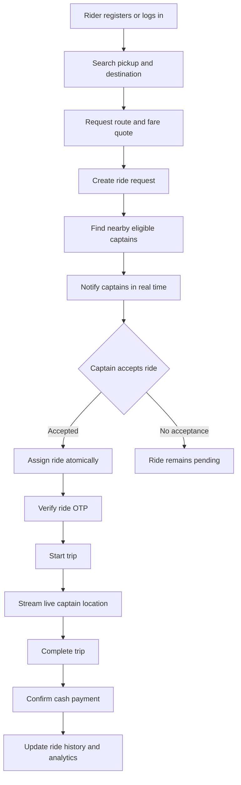
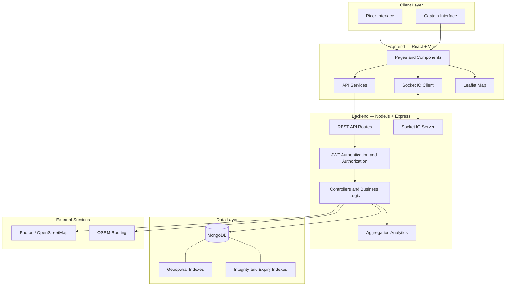

# 🚖 ApnaRide — Real-Time Ride-Hailing Platform
https://apnaride.onrender.com/

### A full-stack ride-booking system with geospatial dispatch, live GPS tracking, concurrency-safe ride management, and captain analytics.

ApnaRide is a MERN-stack ride-hailing application that connects riders with nearby captains through real-time ride dispatch. It combines location-aware matching, route and fare estimation, authenticated WebSocket communication, OTP-verified ride initiation, and data-driven earnings analytics in a single application.

Unlike a basic CRUD project, ApnaRide addresses several real-world backend engineering challenges: finding nearby service providers, coordinating concurrent ride requests, maintaining valid ride states, synchronizing live location data, and enforcing role-specific access.

<p align="center">
  <a href="https://github.com/bhav-1007/ApnaRide">
    
  </a>
  
  
  
</p>

---

## 📌 Table of Contents

- [Overview](#-overview)
- [Core Features](#-core-features)
- [User Roles](#-user-roles)
- [Ride Lifecycle](#-ride-lifecycle)
- [System Architecture](#-system-architecture)
- [Technical Highlights](#-technical-highlights)
- [Technology Stack](#-technology-stack)
- [API Reference](#-api-reference)
- [Data and State Management](#-data-and-state-management)
- [Project Structure](#-project-structure)
- [Security Considerations](#-security-considerations)
- [Engineering Challenges](#-engineering-challenges)

---

## 🚀 Overview

Traditional ride-hailing applications require more than a booking form. They need to coordinate two different user roles, match ride requests with available drivers, handle competing acceptance requests, and keep both parties synchronized as a trip progresses.

ApnaRide brings these workflows together through a React frontend, an Express and Node.js backend, MongoDB persistence, and Socket.IO real-time communication.

### What makes ApnaRide technically interesting?

- **Geospatial dispatch:** Uses MongoDB's geospatial capabilities to identify nearby active captains based on pickup coordinates and vehicle type.
- **Concurrency-safe ride acceptance:** Prevents multiple captains from successfully accepting the same pending ride.
- **Real-time communication:** Uses authenticated Socket.IO connections and dedicated user, captain, and ride rooms.
- **Live location tracking:** Streams captain location updates while online.
- **OTP-verified ride initiation:** Requires ride verification before the captain starts the trip.
- **Database-level consistency:** Uses partial unique indexes to enforce important active-ride constraints.
- **Captain analytics:** Calculates earnings and related statistics through MongoDB aggregation pipelines.

## ✨ Core Features

### 🧍 1. Rider Experience

The rider-facing workflow covers ride discovery, booking, active-trip monitoring, and trip history.

- **Account registration and login** with JWT-based authentication.
- **Location search and suggestions** through the Photon/OpenStreetMap ecosystem.
- **Route and fare estimation** using OSRM-based routing and vehicle-specific fare quotes.
- **Ride booking** with pickup and destination details.
- **Nearby captain dispatch** for eligible active captains.
- **Real-time ride updates** through Socket.IO.
- **Live captain location visibility** during an active ride.
- **Ride cancellation** through a dedicated cancellation endpoint.
- **Cash-payment confirmation** through the ride payment endpoint.
- **Active ride retrieval** to restore the current ride state.
- **Paginated ride history** with filtering support.

### 🛵 2. Captain Experience

The captain-facing workflow supports availability management, ride discovery, trip execution, and earnings monitoring.

- **Captain registration and login**, including vehicle information.
- **Online/offline availability management.**
- **GPS location updates** while online.
- **Nearby ride discovery** using the captain's location.
- **Vehicle-compatible ride matching.**
- **Ride acceptance** with atomic state-transition protection.
- **OTP-based ride initiation.**
- **Ride completion** through a dedicated endpoint.
- **Earnings and activity statistics** generated using MongoDB aggregation.
- **Active ride retrieval and paginated ride history.**

### 📍 3. Geospatial Ride Dispatch

Ride matching is based on actual geographic coordinates rather than a simple list of available drivers.

The backend stores pickup locations in GeoJSON format and uses a MongoDB `2dsphere` index to query nearby captains. Dispatch considers captain availability and the requested vehicle type.

This enables location-aware matching and avoids the need to calculate distances manually against every captain in application code.

### ⚡ 4. Real-Time Communication

ApnaRide uses Socket.IO for bidirectional communication between the backend and connected clients.

The documented room structure separates communication into:

- `user:<id>` — user-specific updates.
- `captain:<id>` — captain-specific updates.
- `ride:<id>` — updates associated with an individual ride.

Socket authentication uses a JWT handshake. The rider interface combines the active-ride API with real-time events, while online captains periodically transmit location updates.

### 🔐 5. Authentication and Account Recovery

The authentication system includes separate rider and captain registration/login flows.

Documented mechanisms include:

- JWT authentication with role claims.
- Role-aware access to rider and captain functionality.
- Token invalidation through a logout blacklist with TTL-based cleanup.
- Password-reset OTPs stored as hashes.
- OTP expiry after 15 minutes.
- Lockout after five incorrect OTP attempts.

These mechanisms address authentication, session invalidation, and account-recovery risks beyond a basic login implementation.

### 💰 6. Route and Fare Estimation

Before booking, riders can request route and fare information for supported vehicle categories.

- Place suggestions using Photon/OpenStreetMap.
- Route information using OSRM.
- Fare quotes for supported vehicle types.
- Booking based on pickup and destination information.

The routing and location-search integrations keep geographic services separate from the core ride lifecycle.

### 📊 7. Captain Earnings Dashboard

Captain statistics are calculated using MongoDB aggregation rather than requiring the application to retrieve and manually process every completed ride.

The documented aggregation uses `$facet` to derive multiple analytical views in one pipeline, with time-based buckets aligned to the application's configured timezone.

This provides a foundation for displaying earnings summaries and ride-related statistics.

### 🧾 8. Ride History and State Recovery

The application exposes endpoints for retrieving the active ride and paginated historical rides.

The frontend can reconstruct the current ride from the backend's persisted state instead of relying exclusively on transient browser state or previously received socket events.

This separation is important when a user refreshes the page or reconnects after a temporary network interruption.

---

## 🔄 Ride Lifecycle

A typical ride progresses through the following stages:



The diagram represents the intended application workflow. Actual behavior depends on the implemented validation and state-transition rules for each endpoint.

### Why the state transitions matter

Ride requests are shared resources. If multiple captains attempt to accept the same request, the backend must ensure that only one can claim it.

ApnaRide documents a conditional atomic database update for ride acceptance. Competing requests cannot both transition the same pending ride successfully.

---

## 🏗️ System Architecture

ApnaRide follows a client-server architecture with a REST API for request-response operations and Socket.IO for real-time events.



### Architectural responsibilities

| Layer | Responsibility |
|---|---|
| React frontend | Rider and captain interfaces, navigation, application state, and user interactions |
| API services | Communication between the frontend and REST endpoints |
| Socket.IO client | Joining rooms and receiving real-time ride and location updates |
| Express API | Request routing, authentication middleware, and application operations |
| Controllers and models | Ride workflows, captain operations, persistence, and business rules |
| Socket.IO server | Authenticated real-time communication between clients |
| MongoDB | Persistent application data, geospatial queries, and database indexes |
| External map services | Place suggestions, route information, and geographic presentation |

---

## 🧠 Technical Highlights

### 1. Atomic Ride Acceptance

The documented ride-acceptance flow uses a conditional database operation equivalent to:

```javascript
findOneAndUpdate(
  {
    _id: rideId,
    status: "pending"
  },
  {
    $set: {
      status: "accepted"
    }
  }
);
```

This is an illustrative representation of the conditional state transition, not a complete copy of the production controller.

The important detail is the condition on `status: "pending"`: only a ride that remains pending can be claimed through that operation.

A successful acceptance can return `200`, while a competing request that loses the race can return `409 Conflict`.

### 2. Database-Enforced Active-Ride Constraints

Application validation alone is not sufficient when requests execute concurrently.

ApnaRide documents partial unique indexes designed to enforce these invariants:

- A rider cannot have multiple live rides.
- A captain cannot be assigned multiple simultaneous rides.

These constraints provide a second layer of protection at the database level.

### 3. Geospatial Queries

MongoDB geospatial indexing supports proximity-based captain discovery.

The documented implementation uses:

- GeoJSON pickup coordinates.
- A `2dsphere` index.
- Proximity queries using `$near`.
- Captain availability and requested vehicle type as matching criteria.

This makes geographic matching part of the database query rather than an expensive application-level scan.

### 4. Authenticated Socket.IO Rooms

Socket connections are authenticated using JWTs during the handshake.

Separating user, captain, and ride rooms allows events to be targeted at the relevant participants instead of broadcasting every ride update to every connected client.

Room membership and event authorization must remain server-controlled so clients cannot access other users' private ride updates.

### 5. Token Blacklisting and TTL Cleanup

The documented logout flow blacklists invalidated tokens, with a MongoDB TTL index used to remove expired blacklist records.

This helps implement server-side token invalidation without requiring blacklist records to remain indefinitely.

### 6. Aggregation-Based Analytics

MongoDB `$facet` allows multiple analytical calculations to share a common aggregation pipeline.

For a captain earnings dashboard, this can reduce repeated queries and centralize calculations around completed rides and the application's timezone rules.

---

## 🛠️ Technology Stack

| Category | Technologies |
|---|---|
| Frontend | React 18, Vite |
| Styling | Tailwind CSS |
| Routing | React Router |
| Maps | Leaflet, OpenStreetMap tiles |
| Client-server communication | Axios, REST APIs |
| Real-time communication | Socket.IO, Socket.IO Client |
| Backend | Node.js, Express.js |
| Database | MongoDB, Mongoose |
| Authentication | JSON Web Tokens, bcrypt |
| Validation and protection | express-validator, express-rate-limit, Helmet |
| Email capability | Nodemailer |
| Geographic search | Photon / OpenStreetMap |
| Route estimation | OSRM |
| Development tooling | npm, concurrently, Node.js watch mode |

---

## 📡 API Reference

The following table summarizes the documented application endpoints. Authentication and authorization requirements should be verified against the corresponding route middleware before extending the API.

### Authentication

| Method | Endpoint | Purpose |
|---|---|---|
| `POST` | `/users/register` | Register a rider |
| `POST` | `/users/login` | Authenticate a rider |
| `POST` | `/captains/register` | Register a captain with vehicle information |
| `POST` | `/captains/login` | Authenticate a captain |

### Location and Route Information

| Method | Endpoint | Purpose |
|---|---|---|
| `GET` | `/maps/suggestions?input=` | Search for location suggestions |
| `POST` | `/rides/quote` | Calculate route and fare estimates |

### Ride Management

| Method | Endpoint | Purpose |
|---|---|---|
| `POST` | `/rides` | Create a ride request |
| `GET` | `/rides/nearby` | Retrieve nearby pending rides for a captain |
| `POST` | `/rides/:id/accept` | Accept a pending ride |
| `POST` | `/rides/:id/cancel` | Cancel a ride |
| `POST` | `/rides/:id/start` | Start a ride using OTP verification |
| `POST` | `/rides/:id/end` | Complete a ride |
| `POST` | `/rides/:id/pay` | Confirm cash payment |
| `GET` | `/rides/active` | Retrieve the active ride |
| `GET` | `/rides/history?page=&limit=&status=` | Retrieve paginated ride history |

### Captain Operations

| Method | Endpoint | Purpose |
|---|---|---|
| `PUT` | `/captains/status` | Update online/offline status |
| `POST` | `/captains/location` | Submit captain location |
| `GET` | `/captains/stats` | Retrieve captain analytics |

**Note:** This is a high-level API reference, not a complete OpenAPI specification. Request bodies, response schemas, error formats, and authorization rules should be documented from the actual route and controller implementations.

---

## 🗄️ Data and State Management

The application uses MongoDB through Mongoose. Its key domain concepts include riders, captains, rides, authentication tokens, and account-recovery data.

| Domain | Important responsibilities |
|---|---|
| Rider | User identity, authentication, and ride ownership |
| Captain | Authentication, vehicle details, availability, location, and ride assignment |
| Ride | Pickup and destination, ride status, participants, OTP verification, fare, and payment state |
| Token blacklist | Invalidated authentication tokens and expiry-based cleanup |
| Password-reset records | Hashed OTPs, expiry, and failed-attempt restrictions |

The table describes the documented domain responsibilities, not a verified list of exact Mongoose schema fields.

### State consistency principles

- Validate transitions instead of accepting arbitrary ride-status changes.
- Use atomic conditional updates for competing operations.
- Enforce critical uniqueness constraints through database indexes.
- Derive the active ride from persisted backend state.
- Keep real-time events synchronized with committed database changes.
- Apply pagination to historical records rather than loading everything at once.

---

## 📁 Project Structure

The repository separates the frontend, backend, and API-related code into top-level directories.

```text
ApnaRide/
├── api/                  # API-related project files
├── backend/              # Express API and server-side logic
├── frontend/             # React + Vite client application
├── .env.example          # Environment-variable template
├── .gitignore
├── package.json          # Root development scripts
├── package-lock.json
├── vercel.json           # Deployment configuration
└── README.md
```

### Frontend organization

The documented frontend architecture includes:

```text
frontend/
└── src/
    ├── components/       # Reusable interface components
    ├── pages/            # Rider and captain screens
    ├── layouts/          # Layout composition
    ├── services/         # API client and service calls
    ├── hooks/            # Reusable hooks, including socket handling
    ├── context/          # Shared application state
    └── utils/             # Shared utilities
```

### Backend organization

The documented backend follows an MVC-style separation of concerns, with areas for routes, controllers, models, utilities, and configuration. Consult the current repository tree for the exact filenames and module boundaries.

---

## 🔐 Security Considerations

ApnaRide documents several protections, including JWT authentication, role claims, logout token blacklisting, hashed password-reset OTPs, expiry controls, and rate limiting dependencies.

For a production deployment, verify the following:

- Authentication and role authorization are enforced server-side.
- Socket.IO connections authenticate correctly and room membership is authorized.
- Sensitive ride details are never exposed through unrestricted broadcasts.
- Passwords and reset OTPs are never stored in plaintext.
- All ride operations validate ownership and permitted state transitions.
- Request payloads and query parameters are validated.
- Secrets are managed through environment variables.
- CORS is restricted to intended origins.
- Database indexes are created and verified during deployment.
- Error responses do not expose secrets or internal stack traces.
- Location data is only accessible to authorized participants and retained appropriately.

Security middleware in `package.json` indicates available dependencies, not proof that every protection is correctly configured. Production readiness requires reviewing the actual middleware, configuration, and deployment environment.

---

## 🧩 Engineering Challenges

| Challenge | Engineering approach |
|---|---|
| Finding nearby captains efficiently | GeoJSON coordinates, geospatial indexes, and proximity queries |
| Preventing duplicate ride acceptance | Conditional atomic database updates |
| Maintaining active-ride consistency | Partial unique indexes and server-side state validation |
| Keeping riders and captains synchronized | Authenticated Socket.IO rooms and event-driven updates |
| Recovering state after refresh or reconnect | Fetch persisted active-ride state |
| Handling account logout | Token blacklist with expiry-based cleanup |
| Securing password recovery | Hashed, expiring OTPs and attempt restrictions |
| Generating captain statistics efficiently | MongoDB aggregation with `$facet` |

These implementation choices make ApnaRide a useful project for studying real-time full-stack development, database concurrency, geospatial querying, and state consistency.
---

## 👨‍💻 Author

**Bhavesh Bhatera**

- GitHub: [@bhav-1007](https://github.com/bhav-1007)
- Project Repository: [ApnaRide](https://github.com/bhav-1007/ApnaRide)
## 🌐 Live Demo

**Try ApnaRide live:** [https://apnaride.onrender.com/](https://apnaride.onrender.com/)

Explore the rider and captain workflows, ride booking experience, and real-time features through the deployed application.

If you find the project useful, consider giving the repository a ⭐.

---

<p align="center">
  <strong>ApnaRide — From booking requests to real-time ride coordination.</strong>
</p>
